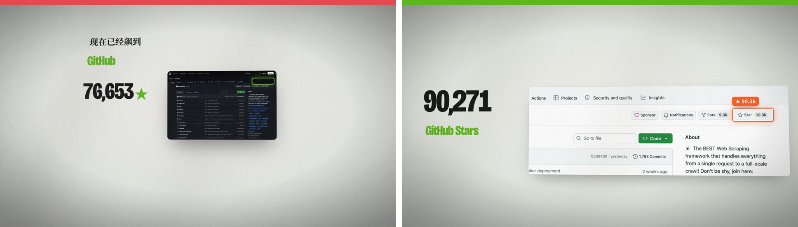
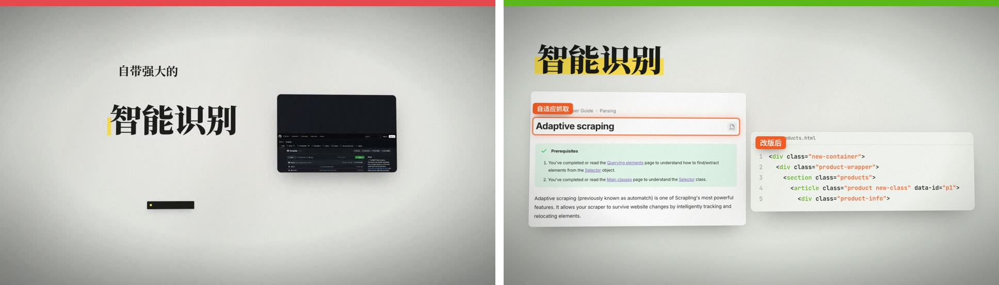
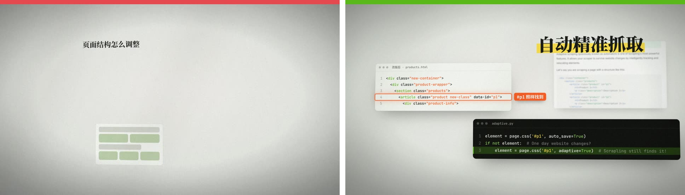
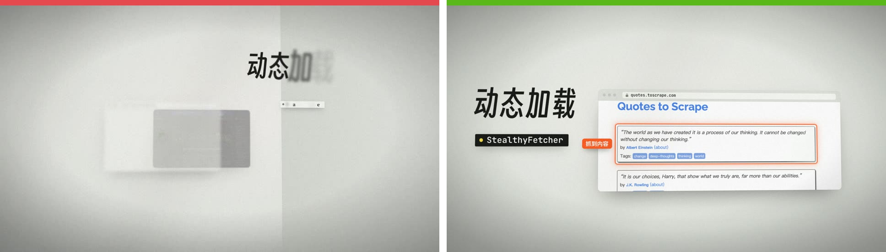
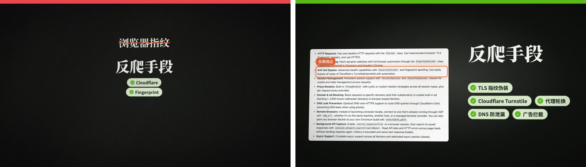
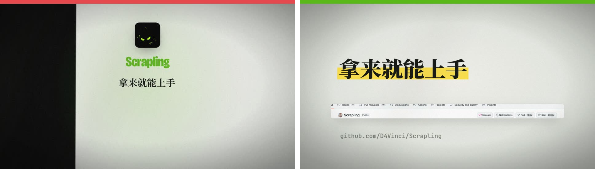
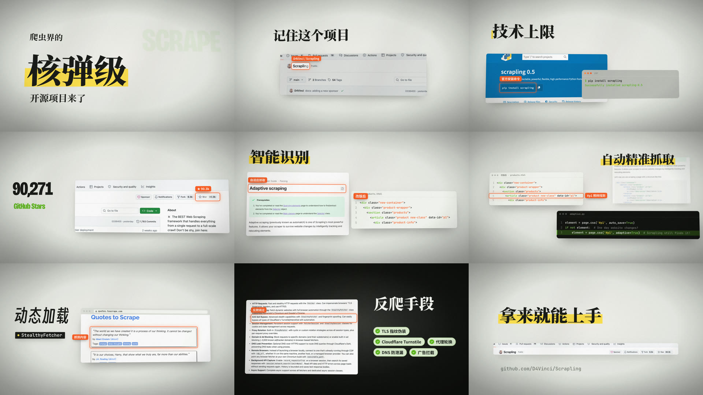

# 03 · 不合格 vs 合格(一页看懂)

同一段口播(Scrapling,27.6 秒)。**左 = 不合格**(红条,已交付的 v2 / v5 成片截帧),**右 = 合格**(绿条,规范 v2 样张 `episodes/_示例_规范v2_scrapling/`)。
一句话标准:**随便抽一帧,都要看得出「产品在干活」。**

---

### 1 · 讲热度:截图要大、要框住证据

| 不合格 | 合格 |
|---|---|
| 仓库页缩成一张小卡片,什么都看不清;数字和截图没有关系 | 仓库页裁到 Star 按钮那一块并放大;数字跳到 API 实数 90,271,框选标签抄页面上的 `★ 90.3k` |

### 2 · 讲功能:用官方文档 + 真实前后对比,不用占位块

| 不合格 | 合格 |
|---|---|
| 大标题 + 一张看不清的暗色截图 + 一条空黑条(字其实在,但被引擎的墨色盖成黑色) | 官方文档截图框住「Adaptive scraping」;前景是官方文档里的改版前 / 改版后 HTML,闪切对比 |

### 3 · 讲原理:真代码逐字敲 + 高亮关键参数

| 不合格 | 合格 |
|---|---|
| 一行小字 + 一块绿色灰色的「假 DOM」占位格子,观众不知道在看什么 | 改版后的 HTML(中景)+ 官方示例代码逐字敲出(前景),`adaptive=True` 那行高亮,HTML 第 4 行被框住:「#p1 照样找到」 |

### 4 · 讲加载:浏览器必须真的出内容

| 不合格 | 合格 |
|---|---|
| 一个空白浏览器窗口在转圈,技术名纸片小到看不见,标题被虚掉 | 地址栏打字 → 转圈 → 真实网页出现,框住抓到的那条内容;技术名纸片 `StealthyFetcher` 清楚可读 |

### 5 · 暗场:满幅、有内容

| 不合格 | 合格 |
|---|---|
| 暗场里只有字和两颗小 pill,大片黑空着 | 满幅暗场里放 README 能力清单截图,逐条框选;右边能力 pills 逐个点亮打勾 |

### 6 · 收尾:不许露竖缝

| 不合格 | 合格 |
|---|---|
| 左边一条黑色竖缝(世界空间的黑底板被视野裁剪隐藏) | 暗场用屏幕空间满幅淡出;收尾是仓库名片条 + 星标脉冲 + 仓库地址 |

---

### 合格样张 9 格(每段一帧)

开场钩子(纯字 ≤3 秒)→ 仓库名框选 → PyPI + 终端安装 → 星标计数 + 框选 → 文档 + 改版对比 → 代码逐字 + 高亮 → 浏览器加载 + 框选 → 暗场能力清单 + pills → 收尾名片条 + 脉冲。

## 一眼判断表
| 看到这些 = 不合格 | 应该是这样 |
|---|---|
| 一段画面只有大标题 + 副句 | 主视觉是 UI / 真实截图,字只做标注 |
| 截图小到读不出字 | 裁到要讲的那块,放大到字能读 |
| 灰色 / 绿色占位块冒充网页、DOM | 真实截图;HTML、代码抄官方原文 |
| 浏览器、终端只在转圈 / 空着 | 转圈之后必须出真实内容 / 成功输出 |
| 框选靠猜位置,框歪了 | 截图时 `--box` 量出位置,框选用 `.box("名字")` |
| 标签写「超强」「秒杀」 | 标签写页面上能看到的事实 |
| 所有东西在同一个深度 | 前景控件 + 中景截图 + 背景弱化 UI |
| 暗场 / 纸底之间露竖缝 | `hz.k.dark` 满幅淡入淡出 |
| 深色块里的字消失、成了空黑条 | 用动画库的代码块 / 深色纸片;自己的深色容器加 `.hz-txt{color:inherit}` |
